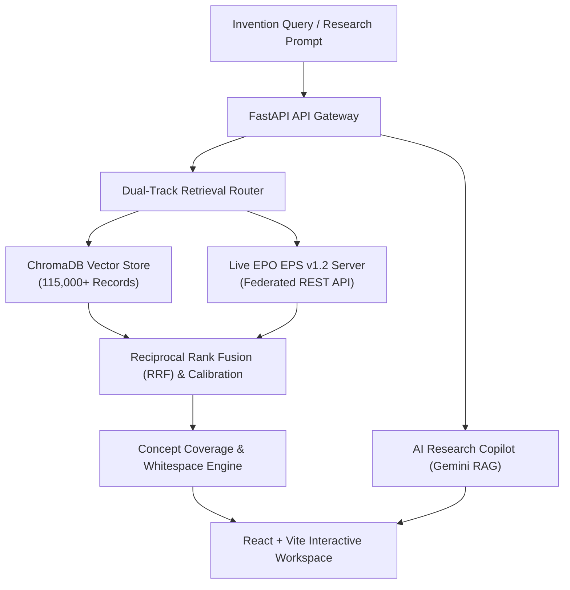

# PatentIQ

<p align="center">
  
</p>

<p align="center">
  <strong>Federated AI Patent Intelligence & Prior-Art Retrieval Platform</strong>
</p>

<p align="center">
  <a href="#features">Features</a> •
  <a href="#architecture">Architecture</a> •
  <a href="#tech-stack">Tech Stack</a> •
  <a href="#quickstart">Quickstart</a> •
  <a href="#api-reference">API Reference</a> •
  <a href="#license">License</a>
</p>

<p align="center">
  
  
  
  
  
  
</p>

---

## Overview

**PatentIQ** is an enterprise AI patent intelligence platform designed for deep-tech innovators, patent attorneys, and R&D engineering teams. It unites a local store of **115,000+ patent records** with **live federated search across the European Patent Office (EPO)** to provide high-precision prior-art discovery, automated novelty assessment, side-by-side claim comparisons, and an interactive AI Research Copilot.

---

## Key Features

- **Dual-Track Hybrid Retrieval**
  - **Dense Semantic Vector Search**: High-dimensional embeddings powered by `all-MiniLM-L6-v2` indexed in **ChromaDB**.
  - **Lexical BM25 Matching**: Exact token and phrase verification across titles, abstracts, and claims.
  - **Reciprocal Rank Fusion (RRF)**: Calibrated Min-Max score normalization.

- **Federated Live Knowledge Expansion**
  - Live on-demand querying against the official **European Patent Office (EPO) European Publication Server (EPS v1.2)**.
  - XXE-protected XML stream parsing with intelligent caching and automated fallback.

- **AI Research Copilot**
  - Conversational patent assistant with multi-turn memory, NLP query parsing, structured citation cards, and exportable research notes.

- **Automated Novelty & Whitespace Scoring**
  - Evaluates technical concepts across a 5-tier coverage spectrum (from *Strongly Represented* to *Unaddressed Gap*).
  - Single canonical 0–100% novelty rating with explicit prior-art similarity factors.

- **Side-by-Side Patent Comparison Matrix**
  - Dual-patent comparison workspace analyzing claim breadth, independent claims overlap, and technical divergence.

- **Modern Enterprise UI / UX**
  - Sleek, high-DPI responsive interface with dark/light themes, collapsible sidebar navigation, and real-time system health metrics.

---

## Architecture



---

## Tech Stack

| Layer | Technologies |
| :--- | :--- |
| **Frontend** | React 18, Vite, Vanilla CSS Design System, Responsive SVG Visualizations |
| **Backend** | Python 3.12, FastAPI, Uvicorn, Pydantic v2 |
| **Vector DB** | ChromaDB, SentenceTransformers (`all-MiniLM-L6-v2`) |
| **AI / LLM** | Google Gemini (`gemini-2.5-flash`) with structured deterministic fallback |
| **External APIs** | European Patent Office (EPO) European Publication Server REST API v1.2 |

---

## Quickstart

### Prerequisites
- **Python 3.10+** (Python 3.12 recommended)
- **Node.js 18+** & `npm`
- **Git**

---

### Step 1: Clone the Repository

```bash
git clone https://github.com/Ashritha1906/PatentIQ.git
cd PatentIQ
```

---

### Step 2: Backend Setup

```bash
# Create and activate Python virtual environment
python -m venv venv

# On Windows:
.\venv\Scripts\activate
# On macOS / Linux:
# source venv/bin/activate

# Install dependencies
pip install -r requirements.txt

# (Optional) Create .env file for Gemini AI Copilot
# GEMINI_API_KEY=your_gemini_api_key_here

# Start the FastAPI server
uvicorn backend.api.main:app --host 127.0.0.1 --port 8000 --reload
```

> **API Documentation**: Once running, open [http://127.0.0.1:8000/docs](http://127.0.0.1:8000/docs) to access the interactive Swagger UI.

---

### Step 3: Frontend Setup

Open a new terminal window:

```bash
cd frontend

# Install node dependencies
npm install

# Start the Vite development server
npm run dev
```

> **Web App**: Open [http://localhost:5173](http://localhost:5173) in your browser.

---

## Project Structure

```
PatentIQ/
├── backend/
│   ├── api/
│   │   ├── main.py              # FastAPI application & middleware
│   │   └── routes/              # Modular API endpoints (search, copilot, novelty, compare)
│   ├── embeddings/              # SentenceTransformer vector pipelines
│   ├── knowledge_expansion/     # Live federated EPO EPS connectors
│   ├── tests/                   # E2E, unit, and retrieval regression tests
│   └── vectordb/                # ChromaDB vector index configuration
├── frontend/
│   ├── public/                  # Public assets & SVG favicon
│   └── src/
│       ├── components/          # Reusable UI components (Logo, Header, Icons)
│       ├── pages/               # Workspace pages (Home, Copilot, Compare, Results)
│       ├── services/            # Frontend API client
│       └── index.css            # Enterprise dark/light design system
├── requirements.txt             # Python dependencies
└── README.md                    # Project documentation
```

---

## API Reference

| Endpoint | Method | Description |
| :--- | :--- | :--- |
| `/api/health` | `GET` | System health, vector DB status, and active LLM configuration |
| `/api/search` | `POST` | Hybrid dense + lexical prior-art retrieval across patent databases |
| `/api/novelty` | `POST` | Canonical novelty score estimation and whitespace concept coverage |
| `/api/copilot/chat` | `POST` | Multi-turn AI Research Copilot conversational analysis |
| `/api/compare` | `POST` | Side-by-side comparative analysis of two patent publications |
| `/api/knowledge/status` | `GET` | Federated live EPO connector bandwidth and cache health |

---

## Testing

Run the test suite from the repository root:

```bash
# Core API endpoints test
python backend/tests/api_tests/test_api.py

# End-to-end retrieval validation
python backend/tests/api_tests/run_e2e_tests.py
```

---

## Disclaimer

*PatentIQ provides automated prior-art similarity indicators and algorithmic novelty assessments. It does not constitute formal legal counsel or an official determination of patentability by a national patent authority.*

---

## License

This project is licensed under the [MIT License](LICENSE).
