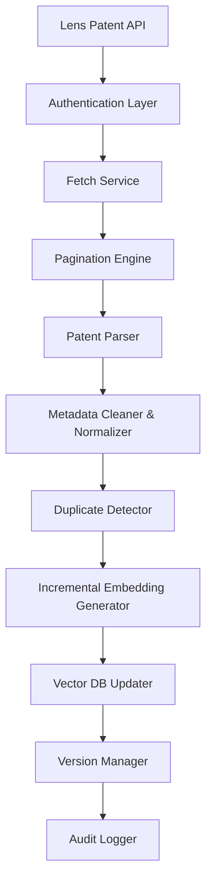

# Live Knowledge Expansion Architecture

This document describes the modular architectural layers that govern the PatentIQ Live Ingestion & Vector Update system.

## Architectural Elements

1. **Authentication Layer (`authentication.py`):** Encapsulates token credential lookup from `.env` and headers formulation (`Authorization: Bearer <key>`). Includes mock verify triggers.
2. **Fetch Service (`lens_client.py`):** Integrates reusable REST search methods using Elasticsearch Query DSL format. Manages connections, rate-limits (HTTP 429), and client exception isolations.
3. **Pagination Engine (`pagination.py`):** Loops over query index pages. Saves and loads page offsets from `sync_checkpoint.json` to resume interrupted execution runs.
4. **Patent Parser (`parser.py`):** Translates raw Lens JSON nodes (nested titles, inventors list, class list, and applicant profiles) into standard flat PatentIQ schema objects. Includes IPC code checks to infer target technology domains.
5. **Normalizer (`normalizer.py`):** Cleans whitespace, normalizes dates to YYYY-MM-DD, standardizes applicant text (stripping common corporate suffixes like LTD, CO, LLC, INC), and constructs the representation text strings for embedding.
6. **Duplicate Detector (`duplicate_checker.py`):** Prevents duplicate entries inside ChromaDB. Looks up patent IDs using Chroma's `.get(ids=[...])` and compares MD5 abstract content hashes of pending documents in the current batch.
7. **Incremental Embedding (`incremental_embeddings.py`):** Reuses the global `SentenceTransformer('all-MiniLM-L6-v2')` model to encode newly imported abstracts. Keeps vector size at exactly 384 dimensions.
8. **Vector DB Updater (`vector_updater.py`):** Inserts vectors and metadatas into the active collection without rebuilds. Executes pre/post database size counts to verify index integrity.
9. **Version Manager (`sync_manager.py`):** Increments version logs (v1 ➔ v2 ➔ v3) and tracks sync statistics.
10. **Audit Logger (`audit_logger.py`):** Appends historical sync records to `sync_history.csv` and outputs report texts (`knowledge_sync_report.txt`, `knowledge_audit.txt`).
