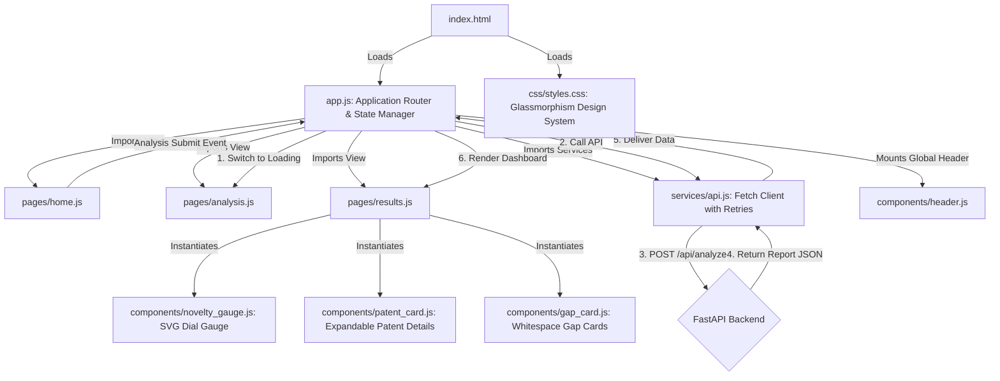

# PatentIQ Frontend Architecture (Phase 5)

This document provides technical design details for the client-side single-page application (SPA).

## Modular Client Architecture

The frontend is designed to run natively in modern browsers using native ES6 module imports (`type="module"`), avoiding compilation overlays or dependency setups.

## Client States & Views

1. **Home View (`pages/home.js`):**
   - Displays the project hero header.
   - Textarea for detailed invention idea input.
   - Input forms for advanced filters (Retrieve count, assignee restriction).
   - SUGGESTION CARDS: Contains 5 diverse technology template suggestion cards that automatically populate the textarea when clicked, helping users test immediately.
2. **Analysis/Loading View (`pages/analysis.js`):**
   - Displays a custom-animated spinning glow loader.
   - Updates progress bars and steps sequentially (Understanding, Retrieving, Ranking, Synthesizing, Compiling) using a smooth tick timer until the API responds.
3. **Results Dashboard View (`pages/results.js`):**
   - **Technology Domain Panel:** Primary classification, core concepts, and keywords.
   - **Novelty Assessment Dial:** Custom SVG Gauge (`components/novelty_gauge.js`) drawing an animated needle pointer and a color gradient fill.
   - **Evidence Matrix:** Programmatic layout of patent alignments, semantic scores, concept coverage, and overall evidence score in a styled HTML table.
   - **Concept Landscape Panel:** ASCII visualization of text clusters.
   - **Confidence Panel:** Visual display of quantitative reliability score (HIGH/MEDIUM/LOW).
   - **Whitespace Gaps Panel:** Renders custom gap cards highlighting unrepresented components.
   - **Gemini Reasoning Panel:** Renders markdown text into formatted paragraphs and lists.
   - **Prior Art Details Panel:** Renders detailed patent cards with toggle buttons to expand and collapse long texts.

---

## Design System Tokens (`css/styles.css`)

The interface features an **Ultra-Premium Glassmorphic Dark Design System** using:
- **HSL Colors:** Base background (`#060913`), surface panels (`rgba(13, 20, 38, 0.65)` with a backdrop blur of `16px`).
- **Gradients:** Dynamic linear gradients for primary buttons, logos, and loaders.
- **Animations:** Smooth transitions for text expansion, pulsing lights under loading icons, slide-up panel entries, and gauge needle sweeps.
