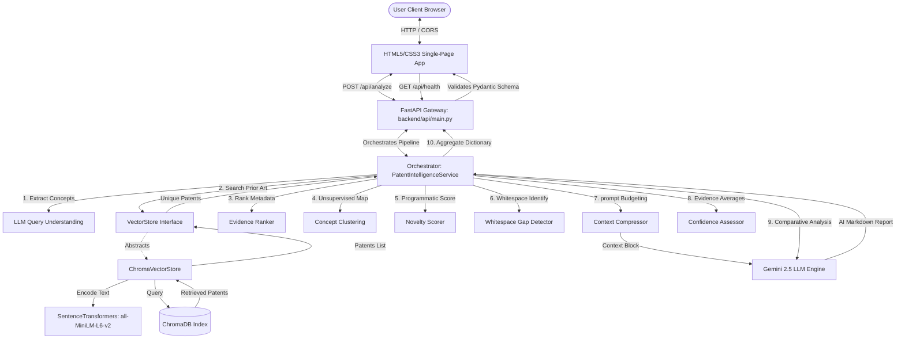

# PatentIQ System Architecture (Phase 5)

The following Mermaid diagram visualizes the request lifecycle, data flow, and components of the PatentIQ platform.

## Request Flow Lifecycle

1. **Query Entry:** The user inputs an invention description into the frontend SPA.
2. **Query Understanding:** The FastAPI backend receives the request and forwards it to the Orchestrator, which utilizes the Gemini client to parse the core problem, isolate keywords, and identify the primary technology domain.
3. **Database Retrieval:** Using the optimized query, the `ChromaVectorStore` encodes the text using SentenceTransformers and queries ChromaDB. Filters are merged during search.
4. **Programmatic Analysis:**
   - The retrieved patents are deduplicated.
   - The `EvidenceRanker` scores the alignment of patents against search variables.
   - The `ConceptClustering` generates ASCII cluster landscapes.
   - The `NoveltyScorer` evaluates similarity overlap, concept uniqueness, and domain saturation.
   - The `GapDetector` highlights unrepresented technical elements.
5. **Generative RAG Synthesis:** The compressed patent details and user idea are submitted to Gemini to generate the 6-part Comparative Novelty report.
6. **Confidence Scoring:** Overall evidence ratings are programmatically calculated.
7. **Response Delivery:** The compiled dictionary is validated by FastAPI against the `PatentIQResponse` Pydantic model and returned to the client browser to render.
